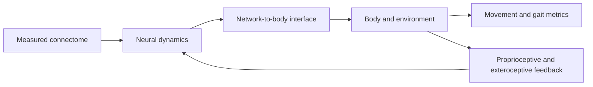

# Flycraft Literature Review

## Connectome-derived motor control, Drosophila ventral nerve cord circuits, and embodied locomotion

- Prepared: 2026-09-07
- Target manuscript: `flycraft_bibm_draft.tex`
- Review type: targeted narrative/scoping review
- Intended use: research notes for later manuscript revision, experiment design, and citation selection
- Scope: Drosophila ventral nerve cord (VNC) connectomics, descending-to-motor pathways, leg coordination and proprioception, embodied fly models, and connectome-based robotic control
- Excluded from this artifact: LaTeX edits, PDF generation, new figures, and paper-ready rewriting

This is not a registered systematic review or meta-analysis. Searches were broad and overlapping, screening was performed by one reviewer, and the included evidence set is curated rather than exhaustive. Endpoint counts below are reported for search transparency; they are not unique-study counts.

## Executive synthesis

1. The male Drosophila VNC connectome is a strong structural substrate for testing circuit hypotheses, but wiring does not uniquely determine neural dynamics, synaptic sign, delays, neuromodulation, or motor recruitment. A connectome-to-body experiment should therefore make its dynamical and interface assumptions explicit ([R1](#r1), [R2](#r2), [R3](#r3), [R26](#r26)).
2. Drosophila motor control is distributed. Descending neurons commonly influence local premotor networks, motor neurons, and inter-leg coordination through multiple parallel routes rather than through one direct command-to-joint mapping ([R3](#r3), [R5](#r5), [R6](#r6), [R30](#r30)).
3. Walking coordination is an embodied phenomenon. Gait depends on neural timing, body geometry, load, friction, stance mechanics, and sensory feedback. A correlation or phase test on motor targets is useful, but it is not equivalent to measured footfall coordination ([R14](#r14), [R16](#r16), [R17](#r17)).
4. Proprioception is not optional detail. Drosophila leg circuits encode position, movement, vibration, and limit events; descending circuits can selectively gate those signals during behavior ([R9](#r9), [R10](#r10), [R11](#r11), [R12](#r12), [R13](#r13)). Flycraft's current no-feedback setup is therefore best interpreted as an open-loop network/interface experiment.
5. Embodied models show the value of a closed loop, but also expose the body-model problem. NeuroMechFly and whole-body fly simulations combine neural or learned controllers with explicit mechanics and sensory channels; their results do not automatically transfer to a non-fly hexapod ([R19](#r19), [R20](#r20), [R21](#r21)).
6. The clearest contribution of the current Flycraft experiment is narrower and defensible: under one fixed network-to-hexapod conversion, measured VNC wiring changes movement relative to matched shuffled-weight controls, while the tested neural signals fail a strict alternating-tripod timing criterion. This separates movement generation from evidence for coordinated walking.
7. The next strongest experiment is to freeze the VNC graph while learning or searching the body interface, then add proprioceptive feedback and evaluate foot contacts, duty factors, phase relations, and target-reaching behavior. That sequence follows the gap identified across connectome simulation, robotics, and locomotion studies ([R18](#r18), [R20](#r20), [R22](#r22), [R24](#r24), [R25](#r25)).

## Conceptual model



The current Flycraft implementation instantiates `C`, a simplified `N`, a fixed `I`, and one simulated `B`. It measures `O` but largely omits the `B -> S -> N` loop. The main interpretive risk is therefore assigning a biological walking claim to an open-loop body-interface result.

## Research questions

1. What does the adult Drosophila VNC connectome justify as a motor-control hypothesis, and what remains underdetermined?
2. What circuit mechanisms support descending control, leg coordination, steering, and proprioceptive feedback?
3. Which metrics distinguish neural activity, body movement, and coordinated walking?
4. What design choices make a connectome-to-robot result informative rather than an artifact of the interface or body model?

## Search and screening record

### Search date and sources

Searches were run on 2026-09-07 using:

- PubMed: primary biomedical literature discovery and abstract-level screening.
- OpenAlex: broad scholarly discovery and citation-neighborhood expansion.
- Crossref: DOI and bibliographic metadata checks for candidate records.
- Publisher and repository pages: eLife, Nature, Nature Communications, Nature Methods, PLOS, Frontiers, PMC, bioRxiv, arXiv, and Janelia FlyEM pages for full-text or abstract verification.
- Semantic Scholar was attempted but returned rate-limit responses; it was not used as evidence.

### PubMed searches

Exact queries and endpoint totals:

```text
(Drosophila[Title/Abstract] OR "fruit fly"[Title/Abstract]) AND ("ventral nerve cord"[Title/Abstract] OR VNC[Title/Abstract] OR connectome[Title/Abstract]) AND (motor[Title/Abstract] OR locomotion[Title/Abstract] OR walking[Title/Abstract])
```

Returned 171 records.

```text
Drosophila[Title/Abstract] AND ("tripod gait"[Title/Abstract] OR "inter-leg coordination"[Title/Abstract] OR locomotion[Title/Abstract])
```

Returned 1,261 records.

```text
(connectome[Title/Abstract] OR neural circuit[Title/Abstract]) AND (robot[Title/Abstract] OR embodied[Title/Abstract] OR locomotion[Title/Abstract])
```

Returned 245 records.

The second query is intentionally broad and includes many non-motor or non-Drosophila locomotion studies. It was used for sensitivity, not as an inclusion list.

### OpenAlex searches

Exact phrase searches and endpoint totals:

| Query | Results returned |
|---|---:|
| `Drosophila male ventral nerve cord connectome` | 760 |
| `Drosophila descending input motor output nerve cord` | 1,331 |
| `Drosophila tripod gait walking speed` | 206 |
| `NeuroMechFly neuromechanical model` | 70 |
| `connectome robotic model C. elegans` | 466 |
| `connectome based reservoir computing` | 819 |
| `Drosophila leg coordination motor circuits` | 1,267 |
| `central pattern generator fly walking connectome` | 181 |

OpenAlex counts are search-endpoint totals, not deduplicated records. Candidate papers were expanded through cited/citing-paper links and then checked against the publisher, PubMed, PMC, or repository record.

### Inclusion criteria

Included studies had to contribute at least one of the following:

- adult Drosophila VNC or brain-and-cord connectome structure, annotation, or cell typing;
- descending, premotor, motor, steering, or leg-proprioceptive circuit evidence;
- quantitative Drosophila gait or inter-leg coordination analysis;
- an embodied Drosophila neuromechanical model;
- a connectome-based robot, reservoir, or whole-body control method that transfers to Flycraft's interface question;
- a computational connectome model with explicit dynamics and behavioral validation.

Excluded: papers unrelated to locomotor control, studies with no transferable method or biological result, duplicate versions when a verified final record was available, and claims available only through search snippets without a stable source page.

### Evidence labels

- **PP**: peer-reviewed primary research.
- **PR**: preprint or emerging manuscript; useful for current direction, not equivalent to settled evidence.
- **M**: methods, software, or computational framework.
- **TR**: transfer evidence from another organism or general connectome-computing literature.

## Evidence map

| Theme | Strongest evidence | Supports | Limitation for Flycraft |
|---|---|---|---|
| Male VNC wiring and annotation | Complete male VNC connectome and systematic cell annotation ([R1](#r1), [R2](#r2)) | Anatomically grounded node and edge selection | Wiring alone does not specify node equations, delays, signs, neuromodulation, or behavior |
| Descending-to-motor organization | DN-to-local-premotor and distributed motor pathways ([R3](#r3), [R5](#r5), [R6](#r6)) | Distributed interface and circuit interpretation | A fixed 260-channel mapping can collapse biological hierarchy and context |
| Steering | DNa01/DNa02 circuit mechanisms ([R7](#r7)) | Turning should be tested with pathway-specific or direction-specific hypotheses | Generic steering input cannot establish DN-specific biological function |
| Motor recruitment | Motor-unit size principle ([R8](#r8)) | Motor channels are not interchangeable scalar outputs | A channel-wise target map may ignore force, recruitment order, and muscle mechanics |
| Proprioception | Position, movement, vibration, inhibition, and limit-detector circuits ([R9](#r9), [R10](#r10), [R11](#r11), [R12](#r12), [R13](#r13)) | Sensory feedback is mechanistically relevant | Current Flycraft is largely open loop |
| Gait and coordination | Speed-dependent or geometry-dependent coordination studies ([R14](#r14), [R15](#r15), [R16](#r16), [R17](#r17)) | Use phase, stance, footfall, duty factor, and body mechanics together | Neural coxa-signal timing is only a proxy for gait |
| VNC connectome dynamics | Dynamic simulation and CPG hypothesis ([R18](#r18)) | DNg100/DNb08-related experiments motivate targeted perturbations | Current result is recent preprint evidence; model assumptions remain important |
| Embodied fly models | NeuroMechFly v1/v2 and whole-body physics ([R19](#r19), [R20](#r20), [R21](#r21)) | Closed-loop body/sensor evaluation and explicit mechanics | Fly body and sensor geometry differ from the hexapod |
| Connectome-to-robot transfer | C. elegans robot and connectome reservoirs ([R22](#r22), [R23](#r23), [R24](#r24)) | Preserve graph structure, expose interface assumptions, compare nulls | Cross-organism transfer is methodological, not biological validation |
| Whole-brain/whole-body context | Whole-brain models and unified brain-and-cord connectomes ([R26](#r26), [R27](#r27), [R28](#r28), [R29](#r29), [R30](#r30)) | Motor control is distributed and embodied | A selected VNC subnetwork may omit relevant sensory and descending context |

## Thematic review

### 1. From wiring map to motor hypothesis

The male Drosophila VNC connectome provides the correct scale and anatomical vocabulary for Flycraft. Takemura et al. assembled a synaptic-resolution male VNC connectome, while Marin et al. supplied systematic cell annotation and functional organization. These resources justify selecting neurons and connections using published cell identities instead of treating the VNC as an undifferentiated random graph ([R1](#r1), [R2](#r2)).

They do not, by themselves, define a controller. A structural edge list leaves several layers unresolved: effective synaptic sign and gain, membrane or activity dynamics, conduction delay, state dependence, neuromodulation, motor-neuron recruitment, and sensory feedback. Shiu et al.'s whole-brain model makes this point operationally: a connectome-constrained leaky-integrate-and-fire model can reproduce and predict multiple sensorimotor responses, but its predictions depend on neurotransmitter estimates and model assumptions ([R26](#r26)).

For Flycraft, the signed-edge construction is therefore a mechanistic hypothesis, not a direct readout of biological synaptic efficacy. The manuscript already acknowledges this by assigning positive or negative effects from neurotransmitter labels and using bounded decaying node activity. The literature supports presenting these choices as a controlled computational instantiation of the connectome rather than as a complete physiological simulation.

The selected network also matters. Flycraft uses a VNC-centered subnetwork with 11,000 model nodes and 485,074 signed connections, then exposes 260 motor signals to an 18-joint hexapod through a fixed conversion. The connectome literature favors this explicit accounting, but it also suggests a limitation: local motor modules are embedded in descending, ascending, and inter-module pathways. A reduced VNC selection should be described as a selected circuit substrate, not as the full Drosophila locomotor controller.

### 2. Descending control is distributed, not a one-neuron joystick

Namiki et al. showed that descending sensory-motor pathways organize access to leg-control circuits through distinct systems. Cheong et al.'s connectome analysis further supports a distributed architecture: direct descending-neuron-to-motor-neuron connections are uncommon relative to routes through local premotor networks, and inter-leg effects can be mediated by other circuit elements ([R3](#r3), [R5](#r5)).

Behavioral studies align with that architecture. Feng et al. found that backward walking is controlled through distributed local and descending elements rather than a single high-level switch. Rayshubskiy et al. identified separable steering contributions from DNa01 and DNa02, including sustained and transient components. These studies make Flycraft's turning result useful as an interface-level phenomenon, but they set a higher bar for a biological steering claim: the input should be connected to a specific identified pathway, and the output should be tested against a directional and temporal prediction ([R6](#r6), [R7](#r7)).

The practical implication is to avoid interpreting the constant DNg100/DNb08 input as equivalent to a natural walking command. It is a reproducible drive condition that can reveal endogenous network dynamics. If it produces forward displacement, that supports the claim that the chosen graph plus interface can shape body motion under the tested conditions. It does not establish that the same cells initiate walking in the same way as in vivo, especially without sensory feedback or a fly-like body.

Motor outputs also have different physiological meanings. Azevedo et al. found a size principle in which slower/smaller motor units are recruited before faster/larger units, with proprioceptive feedback contributing to recruitment. Mapping all selected motor channels directly to joint targets can therefore be a useful first interface, but it should not be described as a biologically faithful muscle controller unless force, recruitment, and muscle mechanics are represented ([R8](#r8)).

### 3. Proprioception closes the control loop

Drosophila leg proprioception is structured, multimodal, and behavior-dependent. Agrawal et al. described central processing of leg proprioception; Chen et al. showed that position, directional movement, and vibration signals converge through distinct second-order pathways and inhibitory gating. Dallmann et al. reported selective suppression of movement-encoding proprioceptive signals during self-generated walking and grooming, while Lee et al. separated local proprioceptive and intersegmental/exteroceptive sensing. Pratt et al. extended the picture with proprioceptive limit detectors that contribute to leg control ([R9](#r9), [R10](#r10), [R11](#r11), [R12](#r12), [R13](#r13)).

This literature changes how to describe Flycraft's current architecture. The absence of full sensory feedback is not a minor implementation omission; it removes a major mechanism by which leg circuits stabilize and coordinate movement. In a fixed open-loop interface, the network cannot respond to foot slip, body pitch, joint limits, load changes, or phase errors. A body can still move, and the graph can still produce structured temporal output, but robust walking is not expected to follow automatically.

The cleanest staged extension is:

1. add joint-angle and joint-velocity feedback;
2. add foot-contact or load feedback;
3. map feedback to anatomically motivated ascending or local VNC channels;
4. test whether feedback improves phase stability, perturbation recovery, and target reaching;
5. compare with shuffled and feedback-matched null models.

This keeps the connectome fixed while testing whether embodiment supplies the missing stabilization mechanism.

### 4. Gait claims require body-level metrics

Wosnitza et al. reported changes in Drosophila inter-leg coordination with walking speed. Szczecinski et al. connected coordination patterns to static stability, and Chun et al. argued that modified tripod coordination persists across speeds while tripod geometry remains important for speed control. Mendes et al. provided quantitative gait analysis in freely walking and sensory-deprived flies ([R14](#r14), [R15](#r15), [R16](#r16), [R17](#r17)).

Together, these studies support three separations:

- **Neural activity:** correlations, phase offsets, oscillation frequency, and motor-channel timing.
- **Kinematic movement:** joint angles, body displacement, yaw, velocity, and turning response.
- **Gait:** footfall events, stance/swing phases, duty factor, leg-group phase, stability, and recovery under perturbation.

Flycraft currently measures the first two and uses coxa motor-signal timing as a gait-related test. That is a reasonable diagnostic, but it should remain labeled a neural timing test. The failed strict alternating-tripod result is informative because it prevents overclaiming. The next validation should derive foot-contact events from the simulator and report per-leg stance/swing phase, duty factor, stride frequency, and phase-locking values. A body can show tripod-like neural timing without producing tripod footfalls, or produce useful locomotion with timing shifted by mechanics.

The literature also cautions against treating one canonical tripod phase as the only successful gait. Speed, body geometry, friction, load, and sensory state can shift coordination. A strict test is valuable as a preregistered target, but secondary metrics should report a continuum of coordination and stability rather than only pass/fail.

### 5. Connectome dynamics and central pattern generation

Pugliese et al. used dynamic simulations across multiple fly VNC connectome datasets to identify a candidate walking central pattern generator and reported DNg100 as a strong driver, with DNb08 implicated and tested through optogenetic experiments. This is the closest current literature to Flycraft's use of constant DNg100/DNb08 drive ([R18](#r18)).

The result motivates targeted Flycraft analyses: input sweeps, ablations, sign-preserving perturbations, frequency response, and phase changes under DNg100-only versus DNb08-only drive. It does not remove the need for caution. The work is recent preprint-level evidence, and CPG conclusions depend on the chosen node dynamics, dataset, and validation protocol. Flycraft should cite it as an emerging mechanistic anchor, not as proof that its current network is a biological CPG.

### 6. Embodied Drosophila models expose the body-interface problem

NeuroMechFly v1 combined an articulated Drosophila body, physics, muscles, and neural controllers. NeuroMechFly v2 added richer visual and olfactory sensors, ascending feedback, complex terrain, and connectome-constrained visual processing. These models make a key methodological point: a neural controller cannot be evaluated independently of body geometry, sensors, mechanics, and environment ([R19](#r19), [R20](#r20)).

Vaxenburg et al. built a detailed whole-body physics simulation and learned an interface that reproduces walking and flight behavior. The work is valuable for mechanics and validation, but it does not claim to be an exact VNC simulation. This distinction is directly relevant to Flycraft: replacing the fly body with a six-legged robot is a legitimate transfer experiment, but the result must be framed as a test of network-to-body transfer, not as a reproduction of fly locomotion ([R21](#r21)).

The current fixed conversion is therefore not merely a convenience. It is the experimental object. It determines which graph-level differences become joint-level differences. Matching per-joint temporal standard deviation across shuffled controls is a useful control for one confound, but it does not match cross-joint covariance, phase, torque, energy, contact timing, or body-state feedback. Future interface training should preserve a held-out evaluation protocol and compare against interfaces trained on shuffled or rewired graphs.

### 7. Connectome-to-robot and reservoir-computing transfer

Valencia Urbina et al. connected a simulated C. elegans connectome to a two-wheel robot and observed emergent action patterns, with randomized controls losing the same behavior. This is a useful methodological precedent: graph structure can produce body-level behavior through a deliberately specified sensor-to-neuron and motor-to-actuator interface, but the claim is about the combined graph-plus-interface system ([R22](#r22)).

Damicelli et al. and Suárez et al. formalized connectome-based reservoir computing. Their common pattern is to preserve a fixed recurrent graph and train or optimize a readout. This closely supports Flycraft's planned next stage: freeze the VNC connections while learning an encoder/decoder or motor readout. The learning step should be reported as interface adaptation, not as learning biological synapses ([R23](#r23), [R24](#r24)).

Jin et al.'s recent whole-brain connectomic graph model is an especially relevant emerging comparison because it reports whole-body fruit-fly locomotion with a connectome-constrained message-passing model and compares rewired, random-graph, and MLP baselines. It is a preprint/current conference-era report, so evidence should be treated as provisional. Its main value for Flycraft is experimental design: preserve structure, make sensory-to-motor routing explicit, and compare against graph-statistics-preserving nulls ([R25](#r25)).

### 8. Whole-brain and brain-and-cord context

Whole-brain connectome and computational-model papers broaden the interpretation of a VNC-only system. Dorkenwald et al., Schlegel et al., and Lin et al. established large-scale brain wiring, cell typing, and network statistics. Shiu et al. showed that a connectome-based whole-brain model can connect sensory input to descending and motor outputs, while Stürner et al. compared descending and ascending neurons. Bates et al. reported a unified brain-and-cord architecture in which local sensory feedback loops and long-range pathways jointly influence distributed effectors ([R26](#r26), [R27](#r27), [R28](#r28), [R29](#r29), [R30](#r30)).

This supports a clear boundary for Flycraft: a selected male VNC network can test whether a measured local wiring substrate affects an external body, but it is not a complete brain-and-cord controller. Missing brain input, ascending feedback, state-dependent selection, and body-specific sensory loops are not expected to be recoverable from the fixed VNC output alone.

## Flycraft-specific interpretation

The current manuscript reports:

- a MaleCNS/VNC-centered model with 11,000 model nodes and 485,074 signed connections;
- 260 neural output channels mapped through a fixed conversion to 18 hexapod joint targets;
- constant input to selected DNg100/DNb08 cells;
- no training of VNC connection weights or the current conversion;
- 12 shuffled-weight controls with matched per-joint temporal variation;
- forward displacement and opposite-input turning response;
- a strict alternating-tripod neural timing test;
- no full proprioceptive or exteroceptive feedback.

The evidence supports the following claim hierarchy:

| Claim level | Supported interpretation |
|---|---|
| Strong | The measured graph and fixed interface produce different body-level output from the tested shuffled-weight controls. |
| Strong | The measured system produces forward displacement and a larger heading response under the tested simulation conditions. |
| Strong | The tested neural signals fail the manuscript's strict all-pair alternating-tripod timing criterion. |
| Moderate | The graph contains temporal structure that can be useful to a body interface. This is a model-dependent interpretation. |
| Not established | The system reproduces biological Drosophila walking, a biological CPG, natural DN function, or target-following behavior. |
| Not tested | Whether a learned interface, sensory feedback, or different body mechanics can convert the output into stable coordinated walking. |

The narrow claim is scientifically useful because it isolates a graph/interface effect without hiding the failed gait test. The literature favors retaining that boundary.

## Evidence-to-design implications

| Current or planned experiment | Literature basis | Recommended interpretation or upgrade |
|---|---|---|
| Forward displacement | Embodied models and connectome-to-robot studies ([R19](#r19), [R22](#r22)) | Report as body-level movement under a fixed interface; add velocity, energy, slip, and contact metrics |
| Opposite-input turning response | Drosophila steering circuits ([R7](#r7)) | Report heading response; avoid DN-specific interpretation unless input/output pathways are identified |
| Matched per-joint temporal SD controls | Reservoir and graph-control logic ([R23](#r23), [R24](#r24)) | Keep; add covariance-, degree-, sign-, and weight-preserving nulls |
| Shuffled connection weights | Connectome-to-robot precedent ([R22](#r22), [R25](#r25)) | State which graph statistics are destroyed; compare degree-preserving rewiring and sign-preserving shuffles |
| Strict alternating-tripod test | Gait literature ([R14](#r14), [R16](#r16), [R17](#r17)) | Keep as a high-bar test; add continuous phase/stability metrics and actual footfalls |
| Constant DNg100/DNb08 input | VNC CPG preprint ([R18](#r18)) | Add DNg100-only, DNb08-only, amplitude/frequency sweeps, and ablations |
| Learned decoder while freezing VNC | Reservoir computing and embodied control ([R20](#r20), [R23](#r23), [R24](#r24)) | Define training as interface learning; hold out seeds, body settings, and command conditions |
| No sensory feedback | Proprioception literature ([R9](#r9), [R10](#r10), [R11](#r11), [R12](#r12), [R13](#r13)) | Treat as a central limitation; add feedback before claiming robust gait |
| One hexapod body | Whole-body models ([R19](#r19), [R21](#r21)) | Sweep mass, friction, leg length, delay, and morphology; report transfer limits |
| Male VNC substrate | Male VNC and sex-difference resources ([R1](#r1), [R2](#r2), [R32](#r32)) | Avoid generalizing to all Drosophila; test sex/cell-type differences when data support it |

## Recommended next experiments

### Priority 0: make the current movement result harder to misread

1. Extract simulated foot-contact events and report stance, swing, duty factor, stride frequency, and inter-leg phase.
2. Report joint-target covariance and cross-leg phase in addition to per-joint temporal SD.
3. Add degree-preserving rewiring, sign-preserving weight shuffling, and connection-count-matched nulls.
4. Repeat across independent neural-parameter draws and simulation seeds, not only body starts.
5. Separate neural, kinematic, and gait endpoints in figures and text.

### Priority 1: test mechanism

1. Compare DNg100-only, DNb08-only, combined, and zero-input conditions.
2. Ablate or silence candidate premotor and inter-leg connector groups.
3. Sweep input amplitude and frequency; measure output frequency, phase, and body response.
4. Add closed-loop joint-angle, velocity, contact, or load feedback through anatomically motivated channels.
5. Train the interface on one set of body conditions and evaluate on held-out friction, mass, morphology, and command conditions.

### Priority 2: test transfer and biological scope

1. Compare VNC-only and brain-plus-VNC inputs when an appropriate model becomes available.
2. Compare male and female connectome-derived networks only after cell-type and dataset alignment.
3. Benchmark against a non-connectome recurrent network with matched parameter count and output statistics.
4. Test whether learned-interface gains survive graph rewiring and graph-preserving perturbations.

## Study-by-study notes

| Ref. | Design / evidence | Main result relevant to Flycraft | Limitation or caution |
|---|---|---|---|
| [R1](#r1) | Male VNC connectome; PP | Synaptic-resolution structural substrate | Structure is not a complete dynamical model |
| [R2](#r2) | Complete male nerve-cord annotation; PP | Cell classes and functional organization | Annotation does not guarantee behavioral function |
| [R3](#r3) | DN-to-motor connectome analysis; PP/current revision | Descending input routes through distributed premotor architecture | Current article version and interpretation should be checked at citation time |
| [R4](#r4) | VNC nomenclature; PP | Stable neuron naming and cross-study comparison | Naming resource, not a locomotion experiment |
| [R5](#r5) | Functional DN pathway study; PP | Distinct descending sensory-motor systems | Circuit function depends on behavioral context |
| [R6](#r6) | Backward-walking circuit study; PP | Distributed control rather than one switch | Specific to backward walking and fly body |
| [R7](#r7) | Steering circuit study; PP | DNa01/DNa02 contribute distinct steering dynamics | Natural steering cannot be inferred from generic robot yaw |
| [R8](#r8) | Motor-unit recruitment; PP | Motor output reflects recruitment scale and proprioception | Joint-target mapping lacks full muscle model |
| [R9](#r9) | Leg proprioceptive processing; PP | Central processing of leg sensory state | Biological sensory pathways need an interface model |
| [R10](#r10) | Leg proprioceptor architecture; PP | Position, movement, and vibration streams are structured | Full feedback is absent in current Flycraft |
| [R11](#r11) | Presynaptic inhibition; PR | Descending state can gate proprioceptive signals | Preprint evidence; behavior-specific mechanism |
| [R12](#r12) | Proprioceptive/exteroceptive circuits; PP | Leg sensors separate local and intersegmental functions | Sensor mapping to hexapod remains nontrivial |
| [R13](#r13) | Proprioceptive limit detectors; PP | Limits contribute to sensorimotor control | Recent result; replication and model transfer needed |
| [R14](#r14) | Free-walking gait analysis; PP | Coordination changes with speed | Fly gait is not identical to robot gait |
| [R15](#r15) | Wild-type and sensory-deprived gait quantification; PP | Sensory loss changes gait measures | Supports, but does not specify, a robot controller |
| [R16](#r16) | Static stability and coordination; PP | Body mechanics predict coordination continuum | Static prediction is not closed-loop neural control |
| [R17](#r17) | Tripod geometry across speeds; PP | Body geometry matters to speed control | Gait conclusion depends on measurement and fly body |
| [R18](#r18) | VNC dynamic simulation and CPG hypothesis; PR | DNg100/DNb08 motivate mechanistic tests | Emerging preprint; model and validation assumptions matter |
| [R19](#r19) | NeuroMechFly v1; PP/M | Neural control plus explicit fly mechanics | Fly morphology, not hexapod morphology |
| [R20](#r20) | NeuroMechFly v2; PP/M | Closed-loop sensing and embodied control | More complex than current Flycraft; not a direct control baseline |
| [R21](#r21) | Whole-body fly physics; PP/M | Realistic body simulation and learned control interface | Not an exact VNC model |
| [R22](#r22) | C. elegans connectome robot; TR | Graph-plus-interface can yield emergent robot behavior | Different organism, body, and network |
| [R23](#r23) | Connectome reservoir framework; PP/M | Fixed graph with trainable readout is principled | Reservoir performance depends on task and dynamics |
| [R24](#r24) | Conn2res toolbox; PP/M | Connectome-informed reservoirs are reusable | Not a biological locomotion validation |
| [R25](#r25) | Whole-brain fly graph locomotion model; PR | Graph-constrained model with embodied outputs and nulls | Recent preprint/conference-era evidence |
| [R26](#r26) | Whole-brain LIF model; PP | Connectome plus transmitter predictions can support sensorimotor predictions | Model predictions are not direct experimental truth |
| [R27](#r27) | Whole-brain wiring diagram; PP | Large-scale structural context | Not specific to the selected VNC controller |
| [R28](#r28) | Whole-brain network statistics; PP | Distributed network structure and motifs | Network statistics do not establish behavior |
| [R29](#r29) | Multi-connectome cell typing; PP | Cell identity and connectome comparison | Requires careful dataset/version matching |
| [R30](#r30) | Descending/ascending comparative connectomics; PP | Brain-cord communication is structured in both directions | Does not directly validate a hexapod transfer |
| [R31](#r31) | Unified brain-and-cord connectome; PP | Local feedback and long-range distributed control | Female adult connectome; sex and dataset scope differ |
| [R32](#r32) | Male CNS sex-dimorphism preprint; PR | Male/female structural differences may affect generalization | Preprint and not necessary for current core claim |

## Recommended citation set for the Flycraft paper

If the manuscript needs a compact, high-value citation set, prioritize:

1. Male VNC structure and annotation: [R1](#r1), [R2](#r2).
2. Descending-to-motor organization: [R3](#r3), [R5](#r5), [R6](#r6).
3. Steering and motor output: [R7](#r7), [R8](#r8).
4. Leg feedback: [R9](#r9), [R10](#r10).
5. Gait validation: [R14](#r14), [R16](#r16), [R17](#r17).
6. Embodiment and interface: [R19](#r19), [R20](#r20), [R21](#r21).
7. Connectome-to-robot/interface methodology: [R22](#r22), [R24](#r24).
8. Emerging DNg100/DNb08 and whole-body comparisons: [R18](#r18), [R25](#r25).

Use [R11](#r11), [R13](#r13), [R31](#r31), and [R32](#r32) only when discussing feedback gating, recent developments, or scope/generalization. Mark [R11](#r11), [R18](#r18), [R25](#r25), and [R32](#r32) as preprint/emerging evidence in the bibliography or prose.

## Limitations of this review

- Search endpoint counts were not deduplicated across databases.
- No dual independent screening or formal risk-of-bias scoring was performed.
- Semantic Scholar search was rate-limited and not used for evidence.
- Some eLife and bioRxiv records have versioned publication histories; cite the exact version accessed when finalizing the paper.
- Connectome-to-robot transfer studies were included for methodology, not treated as biological evidence about Drosophila.
- Recent 2026 records may change status or metadata; recheck them before submission.

## References

### R1

Takemura, S.-Y., et al. (2024). **A connectome of the male Drosophila ventral nerve cord.** *eLife*, 13:RP97769. [DOI: 10.7554/eLife.97769](https://doi.org/10.7554/eLife.97769). [eLife record](https://elifesciences.org/reviewed-preprints/97769v1).

### R2

Marin, E. C., et al. (2024). **Systematic annotation of a complete adult male Drosophila nerve cord connectome reveals principles of functional organization.** *eLife*, 13:RP97766. [DOI: 10.7554/eLife.97766](https://doi.org/10.7554/eLife.97766). [Janelia publication record](https://flyconnecto.me/publications/).

### R3

Cheong, H. S., et al. (2026 current article version). **Organization of circuits linking descending input to motor output in the Drosophila male adult nerve cord connectome.** *eLife*, article 96084. [DOI: 10.7554/eLife.96084](https://doi.org/10.7554/eLife.96084). [Current eLife article](https://elifesciences.org/articles/96084).

### R4

Court, R., et al. (2020). **A systematic nomenclature for the Drosophila ventral nerve cord.** *Neuron*, 107(6), 1071–1079.e2. [DOI: 10.1016/j.neuron.2020.08.005](https://doi.org/10.1016/j.neuron.2020.08.005). [PubMed](https://pubmed.ncbi.nlm.nih.gov/32931755/).

### R5

Namiki, S., et al. (2018). **The functional organization of descending sensory-motor pathways in Drosophila.** *eLife*, 7, e34272. [DOI: 10.7554/eLife.34272](https://doi.org/10.7554/eLife.34272). [eLife article](https://elifesciences.org/articles/34272).

### R6

Feng, K., et al. (2020). **Distributed control of motor circuits for backward walking in Drosophila.** *Nature Communications*, 11, 6166. [DOI: 10.1038/s41467-020-19936-x](https://doi.org/10.1038/s41467-020-19936-x). [PubMed](https://pubmed.ncbi.nlm.nih.gov/33268800/).

### R7

Rayshubskiy, A., et al. (2025). **Neural circuit mechanisms for steering control in walking Drosophila.** *eLife*, 13:RP102230. [DOI: 10.7554/eLife.102230](https://doi.org/10.7554/eLife.102230). [PubMed](https://pubmed.ncbi.nlm.nih.gov/40690376/).

### R8

Azevedo, A. W., et al. (2020). **A size principle for recruitment of Drosophila leg motor neurons.** *eLife*, 9, e56754. [DOI: 10.7554/eLife.56754](https://doi.org/10.7554/eLife.56754). [PMC full text](https://pmc.ncbi.nlm.nih.gov/articles/PMC7347388/).

### R9

Agrawal, S., et al. (2020). **Central processing of leg proprioception in Drosophila.** *eLife*, 9, e60299. [DOI: 10.7554/eLife.60299](https://doi.org/10.7554/eLife.60299). [eLife article](https://elifesciences.org/articles/60299).

### R10

Chen, C.-L., et al. (2021). **Functional architecture of neural circuits for leg proprioception in Drosophila.** *Current Biology*, 31(23), 5163–5175.e7. [DOI: 10.1016/j.cub.2021.09.035](https://doi.org/10.1016/j.cub.2021.09.035). [PubMed](https://pubmed.ncbi.nlm.nih.gov/34637749/).

### R11

Dallmann, C. J., et al. (2024). **Presynaptic inhibition selectively suppresses leg proprioception in behaving Drosophila.** *bioRxiv* preprint. [DOI: 10.1101/2023.10.20.563322](https://doi.org/10.1101/2023.10.20.563322). [PMC record](https://pmc.ncbi.nlm.nih.gov/articles/PMC10634730/).

### R12

Lee, J., et al. (2025). **Divergent neural circuits for proprioceptive and exteroceptive sensing of the Drosophila leg.** *Nature Communications*, 16, 4105. [DOI: 10.1038/s41467-025-59302-3](https://doi.org/10.1038/s41467-025-59302-3). [PMC full text](https://pmc.ncbi.nlm.nih.gov/articles/PMC12048489/).

### R13

Pratt, B., et al. (2026). **Proprioceptive limit detectors contribute to sensorimotor control of the Drosophila leg.** *Nature Communications*. [DOI: 10.1038/s41467-026-69333-z](https://doi.org/10.1038/s41467-026-69333-z). [Nature article](https://www.nature.com/articles/s41467-026-69333-z).

### R14

Wosnitza, A., et al. (2013). **Inter-leg coordination in the control of walking speed in Drosophila.** *Journal of Experimental Biology*, 216, 480–491. [DOI: 10.1242/jeb.078139](https://doi.org/10.1242/jeb.078139). [PubMed](https://pubmed.ncbi.nlm.nih.gov/23038731/).

### R15

Mendes, C. S., et al. (2013). **Quantification of gait parameters in freely walking wild type and sensory deprived Drosophila melanogaster.** *eLife*, 2, e00231. [DOI: 10.7554/eLife.00231](https://doi.org/10.7554/eLife.00231). [eLife article](https://elifesciences.org/articles/231).

### R16

Szczecinski, N. S., et al. (2018). **Static stability predicts the continuum of interleg coordination patterns in Drosophila.** *Journal of Experimental Biology*, 221, jeb189142. [DOI: 10.1242/jeb.189142](https://doi.org/10.1242/jeb.189142). [PubMed](https://pubmed.ncbi.nlm.nih.gov/30274987/).

### R17

Chun, S., et al. (2021). **Drosophila uses a tripod gait across all walking speeds, and the geometry of the tripod is important for speed control.** *eLife*, 10, e65878. [DOI: 10.7554/eLife.65878](https://doi.org/10.7554/eLife.65878). [PMC full text](https://pmc.ncbi.nlm.nih.gov/articles/PMC7932689/).

### R18

Pugliese, M., et al. (2026). **Connectome simulations identify a central pattern generator circuit for fly walking.** *bioRxiv* preprint. [DOI: 10.1101/2025.09.12.675944](https://doi.org/10.1101/2025.09.12.675944). [PubMed record](https://pubmed.ncbi.nlm.nih.gov/42094485/). [PMC record](https://pmc.ncbi.nlm.nih.gov/articles/PMC13142387/).

### R19

Lobato-Rios, V., et al. (2022). **NeuroMechFly, a neuromechanical model of adult Drosophila melanogaster.** *Nature Methods*, 19, 620–627. [DOI: 10.1038/s41592-022-01466-7](https://doi.org/10.1038/s41592-022-01466-7). [Nature article](https://www.nature.com/articles/s41592-022-01466-7).

### R20

Wang-Chen, S., et al. (2024). **NeuroMechFly v2: simulating embodied sensorimotor control in adult Drosophila.** *Nature Methods*, 21, 2353–2362. [DOI: 10.1038/s41592-024-02497-y](https://doi.org/10.1038/s41592-024-02497-y). [Nature article](https://www.nature.com/articles/s41592-024-02497-y). [Project site](https://neuromechfly.org/).

### R21

Vaxenburg, R., et al. (2025). **Whole-body physics simulation of fruit fly locomotion.** *Nature*, 643, 1312–1320. [DOI: 10.1038/s41586-025-09029-4](https://doi.org/10.1038/s41586-025-09029-4). [PMC full text](https://pmc.ncbi.nlm.nih.gov/articles/PMC12310536/).

### R22

Valencia Urbina, J., et al. (2023). **Emergent dynamics in a robotic model based on the Caenorhabditis elegans connectome.** *Frontiers in Neurorobotics*, 16, 1041410. [DOI: 10.3389/fnbot.2022.1041410](https://doi.org/10.3389/fnbot.2022.1041410). [Frontiers article](https://www.frontiersin.org/journals/neurorobotics/articles/10.3389/fnbot.2022.1041410).

### R23

Damicelli, F., et al. (2022). **Brain connectivity meets reservoir computing.** *PLoS Computational Biology*, 18(11), e1010639. [DOI: 10.1371/journal.pcbi.1010639](https://doi.org/10.1371/journal.pcbi.1010639). [PLOS article](https://journals.plos.org/ploscompbiol/article?id=10.1371/journal.pcbi.1010639).

### R24

Suárez, L. E., et al. (2024). **Connectome-based reservoir computing with the conn2res toolbox.** *Nature Communications*, 15, 656. [DOI: 10.1038/s41467-024-44900-4](https://doi.org/10.1038/s41467-024-44900-4). [Nature article](https://www.nature.com/articles/s41467-024-44900-4).

### R25

Jin, Y., et al. (2026). **Whole-Brain Connectomic Graph Model Enables Whole-Body Locomotion Control in Fruit Fly.** *arXiv* preprint, arXiv:2602.17997. [arXiv record](https://arxiv.org/abs/2602.17997). Treat as emerging preprint/conference-era evidence.

### R26

Shiu, P. K., et al. (2024). **A Drosophila computational brain model reveals sensorimotor processing.** *Nature*, 634, 210–219. [DOI: 10.1038/s41586-024-07763-9](https://doi.org/10.1038/s41586-024-07763-9). [PubMed](https://pubmed.ncbi.nlm.nih.gov/39358519/).

### R27

Dorkenwald, S., et al. (2024). **Neuronal wiring diagram of an adult brain.** *Nature*, 634, 124–138. [DOI: 10.1038/s41586-024-07558-y](https://doi.org/10.1038/s41586-024-07558-y). [Nature article](https://www.nature.com/articles/s41586-024-07558-y).

### R28

Lin, A., et al. (2024). **Network statistics of the whole-brain connectome of Drosophila.** *Nature*, 634, 153–165. [DOI: 10.1038/s41586-024-07968-y](https://doi.org/10.1038/s41586-024-07968-y). [Nature article](https://www.nature.com/articles/s41586-024-07968-y).

### R29

Schlegel, P., et al. (2024). **Whole-brain annotation and multi-connectome cell typing of Drosophila.** *Nature*, 634, 139–152. [DOI: 10.1038/s41586-024-07686-5](https://doi.org/10.1038/s41586-024-07686-5).

### R30

Stürner, T., et al. (2025). **Comparative connectomics of Drosophila descending and ascending neurons.** *Nature*, 643, 158–172. [DOI: 10.1038/s41586-025-08925-z](https://doi.org/10.1038/s41586-025-08925-z). [Nature article](https://www.nature.com/articles/s41586-025-08925-z).

### R31

Bates, A. S., et al. (2026). **Distributed control circuits across a brain-and-cord connectome.** *Nature*, 656, 957–970. [DOI: 10.1038/s41586-026-10735-w](https://doi.org/10.1038/s41586-026-10735-w). [Nature article](https://www.nature.com/articles/s41586-026-10735-w).

### R32

Berg, S., et al. (2025). **Sexual dimorphism in the complete connectome of the Drosophila male central nervous system.** *bioRxiv* preprint. [DOI: 10.1101/2025.10.09.680999](https://doi.org/10.1101/2025.10.09.680999). Treat as emerging evidence.
